# CourtLens

[](https://github.com/Muddasirr/courtlens/actions/workflows/ci.yml)
[](LICENSE)

Post-match analytics for futsal facilities. Upload a match from one to four fixed cameras and CourtLens tracks every player and the ball, splits the teams, works out possession, passes and shots, and builds per-player stats and heatmaps. Facility staff review it before anything is published.

> **TODO(Muddasir): screenshots.** Add `docs/review.png` (the review screen with a match's events and a player list) and `docs/heatmap.png` (one player's heatmap and stat card). A 10-second GIF of the tracking overlay on real footage would be the strongest single image.

<!--  -->

## Why I built it

Pro leagues get player tracking and event data from 16–20 camera installs and a room of human operators. A five-a-side facility has one to four CCTV cameras and nobody watching. CourtLens copies the league **pipeline shape** (dense tracking → possession → events → identity → human QA) on facility hardware, and is honest about which numbers it's confident in: every metric is labeled `estimated`, `confirmed` or `unavailable`.

## Features

- **Detection and tracking:** YOLO player and ball detection, BoT-SORT tracking, OSNet re-identification, ball-gap interpolation, and offline track stitching.
- **Team and role split:** per-track torso colour plus a SigLIP embedding, clustered into Kit A, Kit B and Kit X (referees and outliers). Spectators and coaches are filtered out by a zero-shot role check.
- **Possession and events:** possession zones, gains and losses, and pass, shot, goal, assist and dribble detection, with a fine-tuned T-DEED event spotter as an option.
- **Court calibration:** staff click 4–8 court landmarks once per camera, so distances and speeds come out in metres and km/h.
- **Multi-camera:** cameras A–D with per-camera time sync (audio, then motion cross-correlation, then a staff fix) and cross-camera identity.
- **Product layer:** facility accounts and roles, signed uploads (local or S3), processing jobs with cancel and retry, a review screen to accept, reject or edit events, an audit log, clips, and share links.

## Architecture

```mermaid
flowchart LR
    up[Match video<br/>cameras A–D] --> ingest[Ingest + normalize<br/>FFmpeg]
    ingest --> sync[Camera sync]
    sync --> track[Detect + track<br/>YOLO · BoT-SORT · OSNet]
    track --> teams[Team + role split<br/>torso colour + SigLIP]
    teams --> poss[Possession]
    poss --> events[Events<br/>rules or T-DEED]
    events --> stats[Player + match stats]
    stats --> review[Staff review]
    review --> publish[Publish + share]
```



| Part | Stack |
|---|---|
| API and workers | Python 3.12, FastAPI, SQLAlchemy, Alembic, Redis job queue |
| Vision | Ultralytics YOLO, BoT-SORT/ByteTrack, torchreid (OSNet), Hugging Face SigLIP, OpenCV |
| GPU runs | Modal (L4) or Kaggle kernels, using the same backend pipeline |
| Storage | PostgreSQL, local disk or S3 |
| Frontend | React, TypeScript, Vite |

The full pipeline and stat definitions are in [ARCHITECTURE.md](ARCHITECTURE.md), requirements in [PRD.md](PRD.md), evaluation gates and results in [EVAL.md](EVAL.md), and the plan to production accuracy in [ROADMAP.md](ROADMAP.md). The repo also contains a padel engine (`padel/`) served from the same app; see [PLATFORM.md](PLATFORM.md).

## Getting started

**Prerequisites:** Docker with Compose. For running tests without Docker: Python 3.12 and Node 20 with Yarn 1.

### Run the app

The backend image installs CPU-only PyTorch from local wheels, so download those once:

```bash
pip download torch torchvision --index-url https://download.pytorch.org/whl/cpu \
  --python-version 3.12 --only-binary=:all: --platform manylinux_2_28_x86_64 -d backend/wheels

docker compose up --build
```

- App: http://localhost:5173
- API docs: http://localhost:8000/docs

On Linux, if Docker Desktop's socket isn't running, point Compose at the system daemon with `export DOCKER_HOST=unix:///var/run/docker.sock`.

The main settings are `VISION_BACKEND=yolo|stub|modal|kaggle`, `YOLO_MODEL` (default `yolov8m.pt`), `VISION_DEVICE=cpu`, `VISION_TARGET_FPS` (default 10), `VISION_TEAM_EMBED=1` and `VISION_ROLE_FILTER=1`. GPU runs on Kaggle and Modal are described in [EVAL.md](EVAL.md).

### Run the tests

```bash
cd backend
python3.12 -m venv .venv && source .venv/bin/activate
pip install torch torchvision --index-url https://download.pytorch.org/whl/cpu
pip install -r requirements.txt -r requirements-dev.txt
pip install --no-deps ultralytics-opencv-headless
ruff check .
pytest tests -q        # 118 tests, about 20 s on CPU

cd ../frontend
yarn install --frozen-lockfile
yarn lint && yarn build
```

## Challenges and what I learned

- **Measure, don't assume, which model is "better."** A YOLO model fine-tuned on football looked like the obvious choice, but on futsal footage the general `yolov8m` found 4–80× more players. On a 4096 px panorama, running detection at 1920 px instead of 640 px took player recall from 0.16 to 0.84. Every default in this repo is backed by a benchmark in [EVAL.md](EVAL.md).
- **Team split is a data problem more than a model problem.** Whole-body SigLIP embeddings got 7 of 12 hand-labelled CCTV players right. Torso colour as the primary signal, with SigLIP at 0.25 weight, got 11 of 12. Adding a zero-shot filter for spectators and coaches raised team accuracy from 64% to 96% on a labelled match and fixed possession splits that had been skewed to 76/24.
- **A wrong number is worse than no number.** Jersey-number reading scored 7% with Tesseract, 1% with TrOCR, and 11% with a trained classifier on SoccerNet. Rather than ship guesses, automatic numbers are off and staff rename players, with the classifier available behind a flag.
- **Tracking is still the weakest link.** Offline track stitching raised IDF1 from 0.46 to 0.58 on SoccerTrack. I tried FP16 inference for an 8–18% speed-up, but it cost 0.02 IDF1, so I kept FP32.
- TODO(Muddasir): add the hardest bug or design decision from building the review and publish flow, which the docs don't cover.

## Limitations and roadmap

Measured results and production targets are in [EVAL.md](EVAL.md) and [ROADMAP.md](ROADMAP.md). The main gaps right now:

- **Events are early.** On a hand-labelled futsal clip, pass detection reaches F1 0.55 with the fine-tuned spotter, and goal recall on broadcast footage is 1 of 12. That's why every event goes through staff review before it's published.
- **Identity switches** still happen in crowded play: about 95–126 ID switches per 600 frames after stitching.
- **Processing time:** on a Modal L4 GPU, a 40-minute match takes about 50 minutes to process.
- **No live mode.** It's post-match only.
- The next step is ground-truth futsal labels (workstream W0 in the roadmap), because every accuracy claim depends on them.

## License

[MIT](LICENSE). Model weights and datasets have their own licences; see [ROADMAP.md §6](ROADMAP.md).
